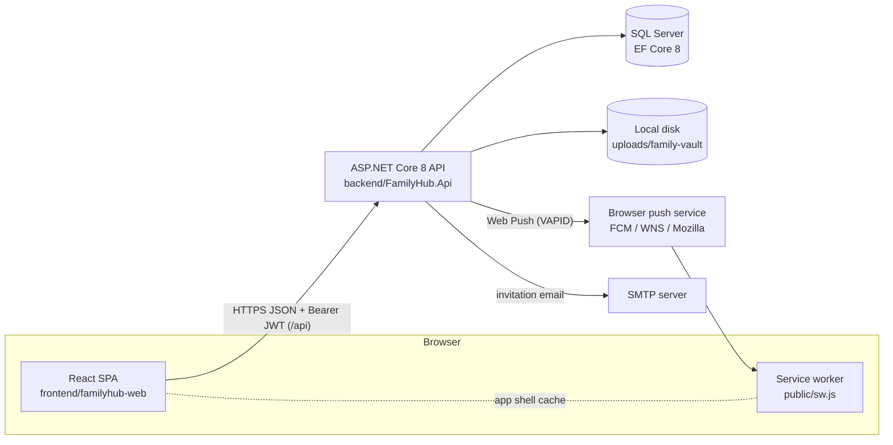
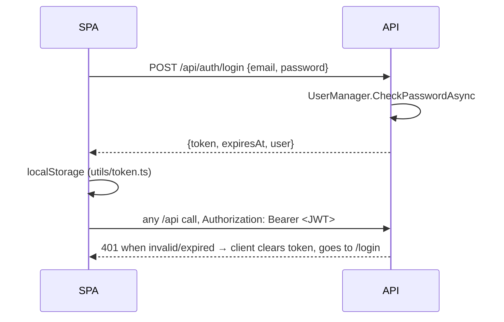
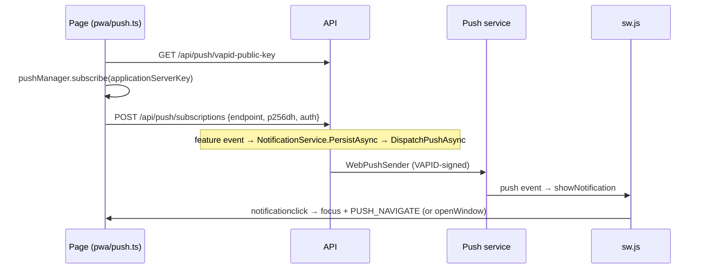

# FamilyHub architecture

This document describes the system **as it is implemented**. Every statement refers to code in this repository. File paths are relative to the repository root. Conventions and the development process are in [AGENTS.md](../AGENTS.md), and local setup is in [README.md](../README.md).

## 1. System overview



- **Hosting modes:**
  - **Dev:** the Vite dev server on `:5173` calls the API on `:5271` cross-origin.
  - **Single-origin:** the built SPA is copied into `backend/FamilyHub.Api/wwwroot` and served by the API itself (`Program.cs`, "Serve the built PWA"). This mode makes the PWA installable and lets the service worker run.
- There is no deployment pipeline or infrastructure-as-code in the repository.

| Layer | Technology (version from `package.json` / `FamilyHub.Api.csproj`) |
|---|---|
| Frontend | React 19, TypeScript 6, Vite 8, React Router 7, Tailwind CSS 4, Axios, React Hook Form, i18next 26 |
| Backend | .NET 8 (`backend/global.json` pins SDK 8.0.201, roll-forward to latest feature band), ASP.NET Core Identity, JWT Bearer 8.0.11, FluentValidation 11, Serilog 8, Swashbuckle 6, WebPush 1.0.13 |
| Data | SQL Server via EF Core 8.0.11. The default is LocalDB (`appsettings.json`) |

## 2. Backend (`backend/FamilyHub.Api`)

### Request pipeline (`Program.cs`, in order)
1. **Forwarded headers:** trusts `X-Forwarded-For` and `X-Forwarded-Proto` from **any** source, because the known networks/proxies lists are cleared. This is a known security risk; see [§12](#12-known-security-risks-separate-s3-review-required).
2. **Serilog request logging.**
3. **`ExceptionHandlingMiddleware`:** turns unhandled exceptions into a 500 `ErrorResponse`. Exception details are included only in Development.
4. **Development:** Swagger UI, plus `DbSeeder.SeedAsync`, which **applies migrations and seeds a sample family** (no-op if it already exists). **Otherwise:** HSTS.
5. HTTPS redirection.
6. **Static SPA files**, only when `wwwroot/index.html` exists. `index.html`, `sw.js` and `*.webmanifest` are `no-store`; hashed assets are cached immutable for one year.
7. **CORS:** any origin in Development, otherwise only `Cors:AllowedOrigins`. No credentials.
8. Authentication, then Authorization, then `MapControllers()`.
9. **SPA fallback** to `index.html`. Unknown `/api` and `/swagger` paths still return 404.

Startup fails fast if `Jwt:Key` is shorter than 32 bytes. Note that the top-level `catch` logs the failure and the process exits with code 0.

### Layering
```
Controllers/  (thin; [Authorize]; validate; call service; map Result → HTTP)
   ↓ Interfaces/I*Service
Services/     (business rules + family authorization; return Result / Result<T>)
   ↓
Data/AppDbContext (EF Core; IdentityDbContext<ApplicationUser>)
```
- **`ApiControllerBase`** provides:
  - `CurrentUserId`, the `NameIdentifier` claim mapped from the JWT `sub`;
  - `HandleResult` / `Error`, which map `ErrorType` to status codes: Validation→400, NotFound→404, Forbidden→403, Conflict→409;
  - `ToValidationProblem`.
- **Validation:** FluentValidation validators in `Validators/` are injected and invoked explicitly in controllers. Auto-validation is not registered.
- **DTOs:** records in `DTOs/<Area>/`. Services map entities through private `ToResponse` methods. `Mapping/` is empty (`.gitkeep` only).
- **Swappable implementations:** `Program.cs` picks them from configuration:
  - email: `SmtpEmailSender` when `Email:Smtp:Host` is set, otherwise `LoggingEmailSender`, which logs the message including the invitation link;
  - push: `WebPushSender` when both VAPID keys are set, otherwise `LoggingPushSender`.

### API surface
All routes are under `/api`. Every controller has a class-level `[Authorize]` except `AuthController` (only `GET /api/auth/me` is authorized) and `HealthController`. No action uses `[AllowAnonymous]`.

| Area | Routes |
|---|---|
| Auth | `POST auth/register`, `POST auth/login`, `GET auth/me` |
| Families | `families`, `families/current`, `families/{familyId}` (+ `/members`) |
| Invitations | `families/{familyId}/invitations` (create, list, resend, cancel), `invitations/{token}/accept` |
| Family features | `families/{familyId}/` `tasks`, `events`, `children`, `pickups`, `documents`, `shopping-lists`. Shopping items: `shopping-lists/{listId}/items` |
| Family Vault | `families/{familyId}/vault/` `vehicles`, `pets`, `home`, `warranties`, `other`, `attachments` |
| Family Expenses | `families/{familyId}/expenses` (list needs `year` + `month`; optional `categoryId`, `paidByUserId`), `expenses/summary?year&month`, `families/{familyId}/expense-categories` (`includeArchived`), `families/{familyId}/expense-budgets` (GET `?year&month`, PUT) |
| Per user | `notifications`, `push`, `reminder-preferences` |
| Dev only | `POST reminders/run` (404 outside Development) |
| Health | `GET health` |

Swagger (Development only) is the authoritative per-action reference.

## 3. Data (SQL Server, EF Core)
- **`AppDbContext`** extends `IdentityDbContext<ApplicationUser>` (Identity tables plus domain tables) and applies every `IEntityTypeConfiguration` in `Data/Configurations/`.
- **Domain entities** (`Models/`):
  - Family core: `Family`, `FamilyMember`, `FamilyInvitation`, `ChildProfile`;
  - features: `FamilyTask`, `FamilyEvent`, `ShoppingList`/`ShoppingItem`, `PickupSchedule`, `FamilyDocument`;
  - vault records: `Vehicle`, `Pet`, `HomeRecord`, `Warranty`, `OtherRecord`, plus polymorphic `VaultAttachment`;
  - expenses: `Expense`, `ExpenseCategory`, `ExpenseBudget`. A budget row applies from its `EffectiveFrom` month until a later row for the same family and category (null = the overall budget) replaces it; a null `Amount` removes the budget from that month on;
  - notifications and reminders: `Notification`, `PushSubscription`, `ReminderHistory`, `UserReminderPreference`.
- **Storage conventions:**
  - Enum columns are stored as strings (`HasConversion<string>()`, 13 occurrences), while JSON serializes enums as integers.
  - Timestamps are `DateTimeOffset`; calendar dates are `DateOnly`.
  - Money is `decimal(12,2)` in MKD (no currency column), with a database check that amounts are positive.
  - Delete behaviors mix `Cascade`, `Restrict` and `NoAction`. Some member references are cleared in code before deletion (`FamilyService` member removal).
- **Migrations:** `Data/Migrations/` holds 15 migrations, from `InitialIdentity` to `AddFamilyExpenses`.
  - The design-time factory `AppDbContextFactory` reads `appsettings.json`, user-secrets, then environment variables.
  - The EF CLI is pinned in `dotnet-tools.json` (8.0.11).

## 4. Authentication

- **Identity** (`AddIdentityCore`):
  - unique email;
  - passwords need at least 8 characters, with a digit, a lowercase and an uppercase letter;
  - no cookies.
- **Tokens** (`Services/TokenService.cs`):
  - HS256 JWT with claims `sub`, `email`, `jti`, `firstName`, `lastName`;
  - issuer and audience from `Jwt` settings, expiry `Jwt:ExpiryMinutes` (default 60);
  - validated with `ClockSkew = 0`;
  - the signing key comes from user-secrets or `Jwt__Key`.
- **Client** (`src/contexts/AuthContext.tsx`, `src/api/client.ts`):
  - on load, a stored token is checked with `GET /api/auth/me`;
  - the Axios interceptor attaches `Authorization: Bearer`;
  - a 401 outside `/auth/login` and `/auth/register` clears the token and redirects to `/login`.
- **Not implemented:** refresh tokens, logout revocation, account lockout, login rate limiting, email confirmation, roles in claims.

## 5. Authorization
There are no authorization policies or role attributes (`AddAuthorization()` with defaults only). `[Authorize]` only requires a valid JWT. **All family-level authorization is done inside services** against the `FamilyMember` table:

1. The family exists, otherwise 404.
2. The caller is a member, otherwise 403.
3. For manage operations, the caller's role is `Owner` or `Parent`, otherwise 403.

Child entities are loaded by `Id` **and** `FamilyId` (for example `FamilyTaskService`). Routes without a `familyId` derive it from the parent entity. Shopping item operations load the list (404 if missing), then check membership in the list's `FamilyId` (403) in `ShoppingListService`. These checks are repeated per service (`AuthorizeAsync`/`GetMembershipAsync` helpers, `VaultServiceBase.AuthorizeAsync` for the vault, and `ExpenseServiceBase.AuthorizeAsync` for expenses, which also denies the `Child` role). There is no shared authorization component.

Roles (`Models/Enums/FamilyRole.cs`): `Owner`, `Parent`, `Member`, `Child`. A user can belong to **only one family** (409 otherwise).

| Operation | Allowed for |
|---|---|
| Create a family | Any authenticated user without a family (becomes `Owner`) |
| Rename family, remove members (never the Owner) | Owner |
| Create, list, resend or cancel invitations | Owner, Parent |
| Manage children, documents and vault records; delete attachments | Owner, Parent (members can read and download) |
| Create, edit or delete pickups; take over a *rejected* pickup | Owner, Parent |
| Confirm, reject or complete a pickup | Only the assigned member |
| Tasks, events, shopping lists | Any family member |
| View and add expenses; view categories | Owner, Parent, Member (**a Child gets 403, even on reads**) |
| Edit or delete an expense | Owner, Parent: any expense. Member: only expenses they created |
| Create, rename, archive, restore or delete expense categories | Owner, Parent |
| View budgets and the monthly summary | Owner, Parent, Member (a Child gets 403) |
| Set or remove budgets | Owner, Parent |
| Notifications, push subscriptions, reminder preferences | The user's own records only |

**Invitations** (`Services/InvitationService.cs`):
- The token is 32 random bytes (hex), stored in plaintext and returned to the inviter in the create response. It expires after `Invitations:ExpiryDays` (7).
- Anyone signed in who holds the token and has no family can accept. Their email is **not** compared with the invited email.
- The frontend keeps a pending token in `sessionStorage` (`utils/pendingInvitation.ts`) across login/registration.
- This token behavior is a known security risk; see [§12](#12-known-security-risks-separate-s3-review-required).

The frontend hides UI using `src/utils/roles.ts`. This is cosmetic only.

## 6. Frontend (`frontend/familyhub-web/src`)

| Folder | Role |
|---|---|
| `api/client.ts` | Axios instance (base URL, JWT, 401 handling) |
| `services/` | One object per domain wrapping API calls |
| `types/` | DTO types and `as const` enum objects (integers matching the backend) |
| `contexts/` + `hooks/` | `AuthContext`, `FamilyContext`, `NotificationsContext` and their hooks |
| `routes/` | Route table and guards |
| `pages/`, `components/`, `layouts/` | UI |
| `pwa/` | Service worker registration and push helpers |
| `locales/` | i18next setup, `en` and `mk` resources |

- **Route guards** (`routes/AppRoutes.tsx`), outermost first:
  1. `/invitations/accept` is reachable whether or not you're signed in.
  2. `PublicRoute` (login, register) redirects users who are already signed in.
  3. `ProtectedRoute` → `FamilyGate` (provides family context) → `RequireFamily` (no family redirects to `/onboarding`) → `AppLayout`.
- **API base URL** (`utils/constants.ts`):
  - `VITE_API_BASE_URL` if set;
  - otherwise on port 5173, the same host on port 5271;
  - otherwise the same-origin `/api`.
- **i18n** (`locales/i18n.ts`): resources `en` and `mk`, fallback `en`, language detected and cached in `localStorage`. Parity is enforced by `scripts/check-i18n.mjs` in CI.
- **Build and lint:**
  - `tsc -b && vite build`, and oxlint (`.oxlintrc.json`).
  - TypeScript runs with `noUnusedLocals`, `noUnusedParameters`, `erasableSyntaxOnly` and `verbatimModuleSyntax`. **`strict` is not enabled.**

## 7. PWA
- **Manifest:** `public/manifest.webmanifest` (`display: standalone`, scope `/`).
- **Registration:** the service worker is registered **only in production builds** (`src/main.tsx`), so Vite HMR is not affected.
- **Service worker** (`public/sw.js`, cache `familyhub-v3`):
  - precaches the app shell and `offline.html`;
  - handles only same-origin GET requests;
  - `/api` requests always go to the network;
  - navigations are network-first, falling back to the cached shell and then `offline.html`;
  - other requests are cache-first, and only `/assets`, `/icons`, `favicon.svg` and the manifest are added to the cache at runtime.
  - On activate, older caches are deleted.
- **Updates:** `pwa/serviceWorkerRegistration.ts` detects a waiting worker. `UpdateNotification` asks the user; `SKIP_WAITING` activates it, and the page reloads once on `controllerchange`.
- **Install:** `InstallPrompt` handles the install offer.

## 8. Notifications

### In-app notifications
- All feature notifications go through `INotificationService` (`Services/NotificationService.cs`).
- `PersistAsync` creates one `Notification` per distinct recipient and **never notifies the actor**. It saves to the database first (the source of truth), then calls `DispatchPushAsync`.
- Typical recipients: the whole family for a new task (`CreateForFamilyAsync`), or Owner and Parent members for a new member or an important vault record.
- The client polls every 60 seconds (`NotificationsContext`, `POLL_INTERVAL_MS`). The API supports listing, unread count, marking one or all read, and deleting one or all read notifications.

### Web Push

- **Subscriptions:**
  - Saved per user and device (unique `EndpointHash`), and re-synced with the backend when the push toggle on the Settings page mounts (`usePushNotifications` → `syncSubscription`).
  - `subscribeToPush` reuses an existing browser subscription **without checking that it matches the current VAPID key**.
- **Delivery** (`PushNotificationService`):
  - runs inline during the request and is best-effort;
  - push service 404/410 → the subscription is deactivated;
  - any other error, including 401/403 from a VAPID key mismatch, is logged and the subscription stays active;
  - a successful send sets `LastUsedAt` and `Notification.IsPushSent`.

### Reminders
- **Engine:** `ReminderBackgroundService` is a hosted service that runs inside every API instance. It waits 15 seconds after startup, then runs `ReminderService.ProcessRemindersAsync` once per day at `Reminders:RunAtHourUtc`.
- **What it checks:** due and expiry dates across tasks, events, documents and vault records, against each user's per-category day offsets (`UserReminderPreference`, defaults in `Common/ReminderCategoryDefaults.cs`).
- **Delivery:** through `INotificationService.CreateForUserAsync`, so reminders also go out as push.
- **No duplicates:** a unique index on `ReminderHistory` (recipient, source, date kind, due date, days before) prevents the same reminder being sent twice.

### Email
`InvitationService` sends invitation emails through `IEmailSender`: SMTP when configured, otherwise the message is logged.

## 9. Family Vault file storage
`Services/FamilyVaultStorage.cs`:
- stores files on local disk under `<content root>/uploads/family-vault/` with random GUID names (gitignored);
- allows at most 5 MB, only `.jpg`/`.jpeg`/`.png`/`.pdf`, and the declared content type must match (the file content is not inspected);
- resolves paths through `ToSafeAbsolutePath` before deletion.

Downloads go through the authorized `VaultAttachmentsController` (`PhysicalFile`). They are never served as static files.

## 10. Configuration and secrets
- **Committed values:** `appsettings.json` contains only non-secret defaults and empty placeholders.
- **Secrets:** come from user-secrets in Development, otherwise from environment variables: `Jwt__Key`, `Push__PublicKey`, `Push__PrivateKey`, `ConnectionStrings__DefaultConnection`, and the `Email__Smtp__*` settings.
- **Logging:** Serilog writes to the console and to `logs/familyhub-.log` (daily rolling files, 7 kept, gitignored).

## 11. Quality gates
The CI jobs in `.github/workflows/ci.yml` and the `main` ruleset are described in [AGENTS.md → CI quality gates](../AGENTS.md#ci-quality-gates). Automated tests are described in [TESTING.md](TESTING.md):
- backend unit tests (xUnit, `backend/FamilyHub.Api.UnitTests`);
- API integration tests: `WebApplicationFactory<Program>` against a disposable Testcontainers SQL Server (`backend/FamilyHub.Api.IntegrationTests`);
- frontend tests (Vitest + React Testing Library, `npm test`).

`Program.cs` ends with `public partial class Program { }` only so that `WebApplicationFactory` can reference the entry point.

## 12. Known security risks (separate S3 review required)
These describe the current behavior. They are **not** fixed by this documentation. Any change to them is an S3 task: it needs its own plan, owner approval, security review and independent Codex review (see [AGENTS.md](../AGENTS.md#required-process-by-level)).

### 12.1 Forwarded headers are trusted from any source
- **Code:** `Program.cs` enables `X-Forwarded-For` and `X-Forwarded-Proto` and clears `KnownNetworks` and `KnownProxies`. `UseForwardedHeaders()` is the first middleware.
- **Effect:** if the API can be reached other than through the trusted reverse proxy, any client can set these headers.
  - A spoofed `X-Forwarded-Proto: https` marks a plain-HTTP request as HTTPS. That bypasses `UseHttpsRedirection` and affects HSTS.
  - A spoofed `X-Forwarded-For` replaces the client IP that ASP.NET Core sees.
  - No application code reads the client IP or scheme today. Any future IP-based control, such as rate limiting or audit logging, would inherit this weakness.
- **Review questions:**
  - Should trust be restricted to the actual proxy address or network?
  - Should the middleware only be enabled behind a proxy?
  - Should `ForwardLimit` be set explicitly?

### 12.2 Invitation tokens act as bearer secrets
- **Code:** `Services/InvitationService.cs`, `Models/FamilyInvitation.cs`.
- **Effect:**
  - The token is stored **in plaintext** in `FamilyInvitations.Token`, so anyone who can read the database holds usable tokens.
  - It is returned to the inviter in the create and resend responses (`CreatedInvitationResponse`).
  - In Development, `LoggingEmailSender` writes the accept link to the logs.
  - Accepting does **not** check that the signed-in user's email matches the invited email. Anyone with the link who has no family joins with the **invited role**, which can be `Parent`, with manage rights.
  - **Resend keeps the same token** and also revives *expired* invitations with a new expiry window, so an old link becomes valid again.
- **Review questions:**
  - Should only a hash of the token be stored?
  - Should acceptance be bound to the invited email?
  - Should the token rotate on resend?
  - Should the token stop being returned in API responses?
  - Should accept attempts be rate-limited?

## 13. Known gaps observed in the code
These are recorded facts, not planned work:
- Automated tests cover representative paths only. There are no E2E/browser tests, and several feature areas have no integration tests yet (see [TESTING.md → Known limitations](TESTING.md#known-limitations-and-gaps)). TypeScript `strict` is off.
- `UpdateReminderPreferenceRequestValidator` throws on a `null` offsets array. It's unreachable through the API today, because `[ApiController]` returns 400 first (see TESTING.md).
- No refresh tokens or token revocation. The JWT is kept in `localStorage`.
- No account lockout or rate limiting on login and register.
- Push: 401/403 responses don't deactivate subscriptions, and stale-key subscriptions are reused on the client.
- Push delivery runs inline in the request. Reminders run in-process in every instance; `ReminderHistory` stops duplicate sends but not duplicate processing.
- Vault files live on the API server's local disk and are validated by extension and content type only.
- Authorization checks are duplicated per service instead of centralized.
- A failed startup exits with code 0.
